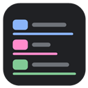
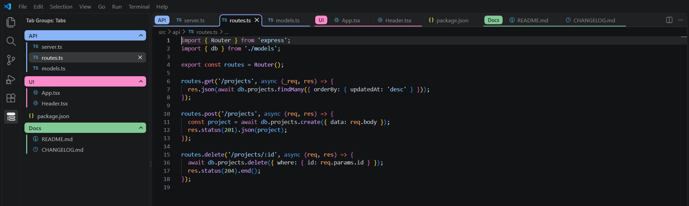
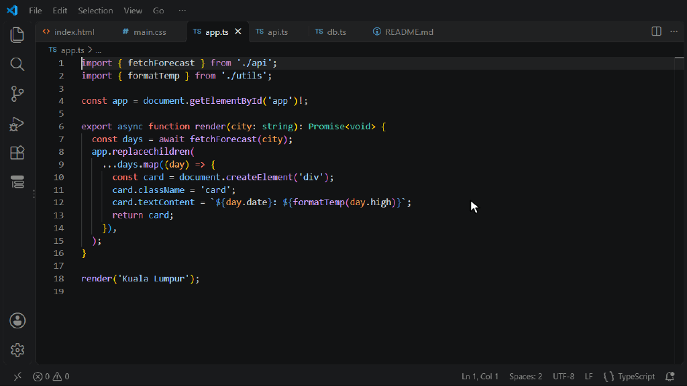
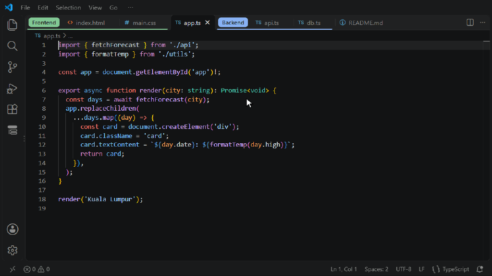
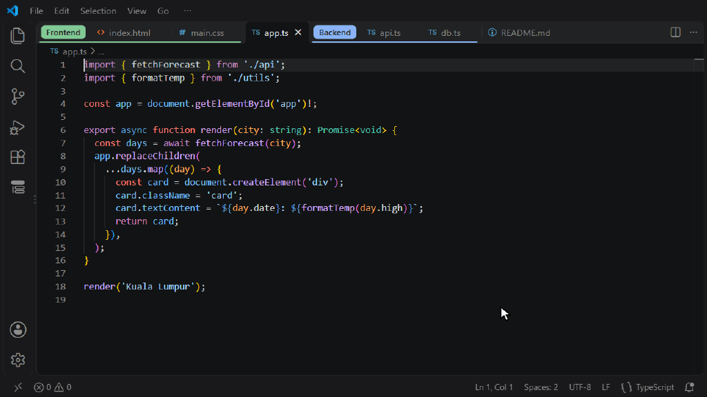
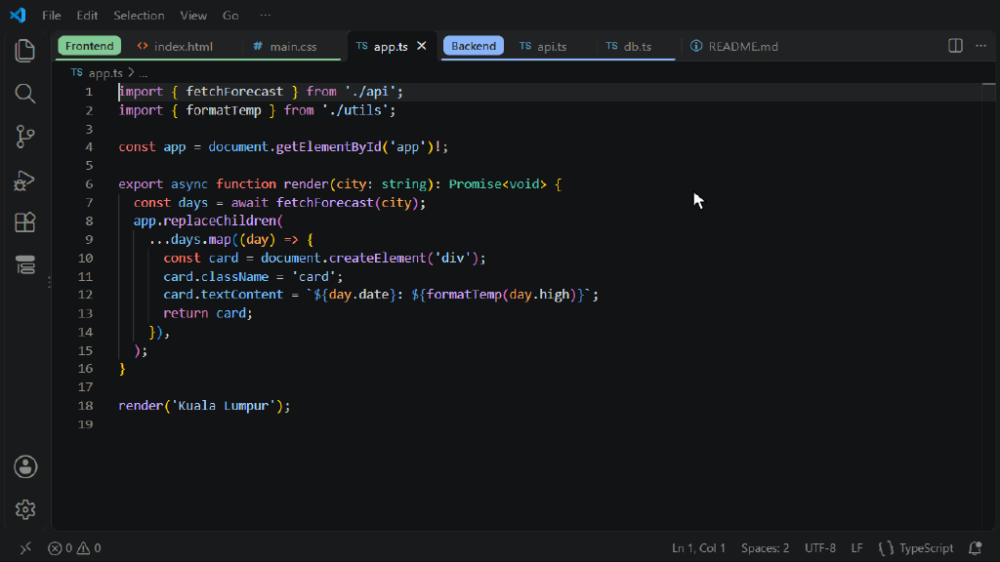
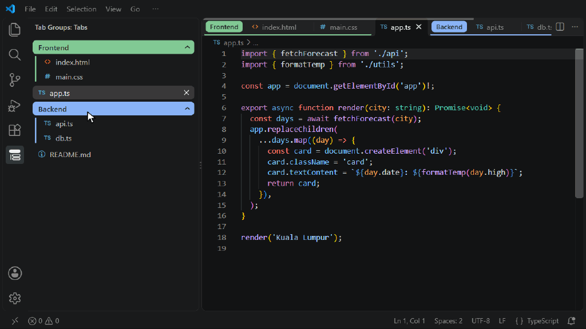
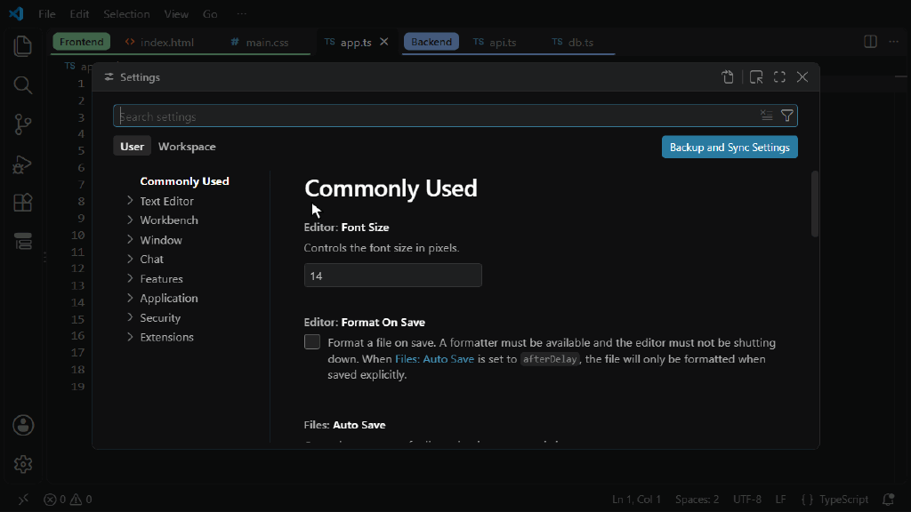

# TabPalette - Tab Groups

**Chrome-style tab groups for VS Code.**

## What it does

Name and color a set of tabs, collapse it to one chip, and drag tabs in and out, right on the tab bar. Groups are saved per workspace, so they come back when you reopen the folder.

## Features

<table>
<tr>
<td align="center" width="50%" valign="top">
<h3>🎨 Make a group</h3>

Right-click a tab → Add Tab to New Group

  
</td>
<td align="center" width="50%" valign="top">
<h3>✏️ Name and color</h3>

Right-click a chip to rename, recolor, close or ungroup

  
</td>
</tr>
<tr>
<td align="center" width="50%" valign="top">
<h3>🖱️ Drag and drop</h3>

Drag tabs into, out of and between groups

  
</td>
<td align="center" width="50%" valign="top">
<h3>📁 Collapse with a click</h3>

Click a chip to hide its tabs, click again to show them

  
</td>
</tr>
<tr>
<td align="center" width="50%" valign="top">
<h3>📋 Side bar</h3>

Every tab in a vertical list, like Chrome's vertical tabs

  
</td>
<td align="center" width="50%" valign="top">
<h3>⚙️ Your colors</h3>

Set the nine colors and chip width in Settings

  
</td>
</tr>
</table>

## Get started

1. Install, click **Enable** when asked, reload the window.
2. Right-click a tab → **Add Tab to New Group**.
3. Drag more tabs onto it.

<b>📖 How to use the tab bar</b>

| To… | Do this |
|---|---|
| Create a group | Right-click a tab → **Add Tab to New Group** |
| Add a tab | Drag it onto the group, or right-click → **Add Tab to Group…** |
| Add several tabs | Ctrl/Shift+click them, then drag or right-click |
| Remove a tab | Drag it out, or right-click → **Remove Tab from Group** |
| Collapse / expand | Click the chip |
| Rename / recolor | Right-click the chip |
| Move a group | Drag the chip |
| Close a group | Chip menu → **Close group**. Reopen with `Ctrl+Alt+T` |
| Ungroup / delete | **Ungroup** keeps the tabs, **Delete** closes them |

<b>📋 How to use the side bar</b>

| To… | Do this |
|---|---|
| Open / close a tab | Click it / click **×** |
| Collapse a group | Click its header |
| Select several | Ctrl+click or Shift+click |
| Group a tab | Drag it onto a group |
| Edit a group | Right-click its header, or press F2 |
| Reopen a closed group | Click it under **Closed groups** |

<b>⌨️ Shortcuts</b>

| Windows | macOS | Linux | Action |
|---|---|---|---|
| `Alt+1` … `Alt+9` | `Ctrl+1` … `Ctrl+9` | `Ctrl+Alt+1` … `Ctrl+Alt+9` | Go to group 1 … 9 (expands it) |
| `Ctrl+Alt+]` / `Ctrl+Alt+[` | `Ctrl+Cmd+]` / `Ctrl+Cmd+[` | `Ctrl+Alt+]` / `Ctrl+Alt+[` | Next / previous group |
| `Ctrl+Alt+C` | `Ctrl+Cmd+C` | `Ctrl+Alt+C` | Collapse or expand the tab's group |
| `Ctrl+Alt+N` | `Ctrl+Cmd+N` | `Ctrl+Alt+N` | Add tab to a new group |
| `Ctrl+Alt+G` | `Cmd+Alt+G` | `Ctrl+Alt+G` | Add tab to a group (the last one used is first) |
| `Ctrl+Alt+Shift+W` | `Cmd+Alt+Shift+W` | `Ctrl+Alt+Shift+W` | Close the tab's group |
| `Ctrl+Alt+T` | `Cmd+Alt+T` | `Ctrl+Alt+T` | Show all groups |

Hold `Alt` (macOS: `Ctrl`, Linux: `Ctrl+Alt`) and each chip and side bar group header shows its key. Change any key in **Keyboard Shortcuts**.

<b>⚙️ Settings</b>

Search **TabPalette** in Settings. Changes apply at once.

| Setting | Default | What it does |
|---|---|---|
| `tabPalette.tabBar.activeTabOutline` | on | Outline around the active tab |
| `tabPalette.tabBar.chipMaxWidth` | 160 | Widest a chip can get (40–400 px) |
| `tabPalette.tabBar.chipTabCount` | off | Tab count on a chip: off, while collapsed, or always |
| `tabPalette.groupColors.color1` … `color9` | Chrome's colors | The nine group colors |
| `tabPalette.ungroupDropLineColor` | red | Drop line when a tab leaves its group |
| `tabPalette.keyboard.showGroupShortcuts` | on | Show each chip's key while its modifier keys are held |

<b>❓ FAQ</b>

**Why does it ask to Enable?**  
VS Code extensions can't draw on the tab bar, so TabPalette adds a small script to VS Code. You can undo it any time.

**VS Code says it is "corrupt".**  
Expected after the script is added. Choose **Don't Show Again**.

**Groups are gone from the tab bar after a VS Code update.**  
Click **Enable** again when asked.

**How do I uninstall?**  
Run **Tab Groups: Disable Chrome-style Tab Groups** first, then uninstall.

**Is it safe?**  
It sends nothing over the network and never changes your settings.

**Limits?**  
Desktop only. Tabs without a file (like Git Graph) are grouped by title.

## Feedback

[Report a bug](https://github.com/JJLIM00/TabPalette/issues) · [Contributing](CONTRIBUTING.md) · [MIT License](LICENSE)
