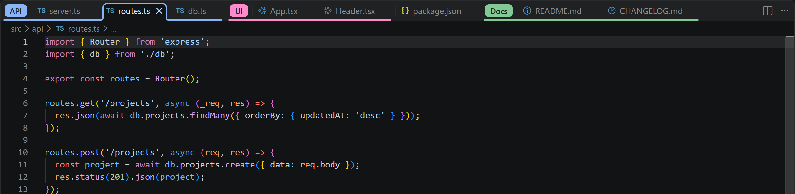
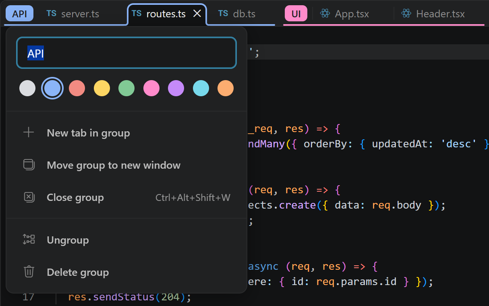
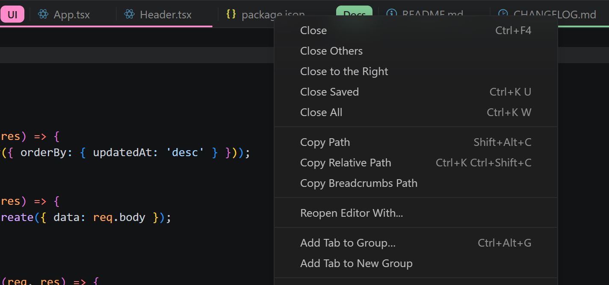
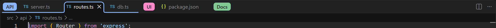

# TabPalette - Tab Groups

**TabPalette** brings Chrome-style tab groups to VS Code. Name and color a group of tabs, collapse it to a single chip, and drag tabs in and out of it, right on the tab bar.



## Features

- **Group chips and lines.** Each group shows a colored chip with its name in front of its tabs, and a line in the group's color runs under them. The active tab in a group gets Chrome's rounded outline.
- **Nine colors, your palette.** Chrome's grey, blue, red, yellow, green, pink, purple, cyan and orange by default, tuned for light and dark themes. Each of the nine can be changed in your settings (see [Custom colors](#custom-colors)).
- **Collapse with a click.** Click a chip to hide the group's tabs and click it again to bring them back.
- **Edit in place.** Right-click a chip to rename the group, pick a color, or close, ungroup or delete it.
- **Drag and drop.**
  - Drop a tab onto any tab of a group to add it to the group, even a group with a single tab. While you hover, the drop line takes the group's color.
  - Drop it on the group's chip instead to place it just before the group, outside it.
  - Drop a grouped tab outside its group (on an ungrouped tab, a chip, or the empty end of the tab bar) to remove it, even right next to the group, e.g. the group's last tab dragged a little to the right. While you hover, the drop line turns red to warn that releasing will ungroup the tab. A group's only tab carries its group along instead.
  - Drag a chip to move the whole group.
- **Groups stay together.** A tab added to a group moves next to it. A tab removed from the middle of a group moves just past the group, so the group never splits.
- **Saved per workspace.** Groups come back when you reopen the folder, including closed groups.



## Getting started

1. Install TabPalette. On first start it asks to **Enable** Chrome-style tab groups (see [How it draws on the tab bar](#how-it-draws-on-the-tab-bar)). Confirm, then reload the window.
2. Right-click a tab and choose **Add Tab to New Group**. Type a name, pick a color, and press Enter.
3. Right-click more tabs and choose **Add Tab to Group…**, or drag them onto the group's tabs.



## Usage

| To… | Do this |
|---|---|
| Create a group | Right-click a tab → **Add Tab to New Group**. The group gets the next free color, and its editor opens so you can name it. |
| Add a tab to a group | Right-click the tab → **Add Tab to Group…**, or drag it onto any tab of the group (the drop line turns the group's color). Dropping it on the chip places it before the group instead. |
| Group several tabs at once | Ctrl/Shift+click the tabs, right-click → **Add Selected Tabs to Group…** |
| Add a file from the Explorer | Right-click the file in the Explorer → **Add Tab to Group…** |
| Remove a tab from its group | Right-click → **Tab Group → Remove Tab from Group**, or drag it out of the group: drop it on an ungrouped tab, a chip, or the empty end of the tab bar. |
| Collapse or expand | Click the chip. Opening a hidden tab (Quick Open, Explorer…) expands its group. |
| Rename or recolor | Right-click the chip. The name updates as you type. Enter or Esc closes the editor. |
| Move a group | Drag its chip to a new place on the tab bar. |
| Close a group | Chip editor → **Close group**. The tabs close and the group is kept; reopen it from **Tab Groups: Show Tab Groups** (`Ctrl+Alt+T`). |
| Ungroup or delete | **Ungroup** keeps the tabs open. **Delete group** closes them too. |

Closing a tab removes it from its group, and a group disappears when its last tab is closed.



### Keyboard shortcuts

| Shortcut | Command |
|---|---|
| `Ctrl+Alt+G` (`Cmd+Alt+G` on macOS) | Add the current tab, or the selected tabs, to a group |
| `Ctrl+Alt+Shift+W` (`Cmd+Alt+Shift+W`) | Close the current tab's group |
| `Ctrl+Alt+T` (`Cmd+Alt+T`) | Show Tab Groups: all groups in this workspace, including closed ones |

Every action is also in the Command Palette under **Tab Groups:**.

### Custom colors

The nine group colors are numbered slots, **Color 1** to **Color 9**. By default they are Chrome's colors, but each slot can be set to any color you like, so you can make your own palette. Together with the red "ungroup" drop line, they are theme colors that you change in your settings:

```jsonc
"workbench.colorCustomizations": {
  "tabPalette.color1": "#9E9E9E",
  "tabPalette.color2": "#4285F4",
  "tabPalette.ungroupDropLine": "#FF9800"
}
```

| Id | Default (Chrome color) | Used for |
|---|---|---|
| `tabPalette.color1` | grey | Color 1 |
| `tabPalette.color2` | blue | Color 2 |
| `tabPalette.color3` | red | Color 3 |
| `tabPalette.color4` | yellow | Color 4 |
| `tabPalette.color5` | green | Color 5 |
| `tabPalette.color6` | pink | Color 6 |
| `tabPalette.color7` | purple | Color 7 |
| `tabPalette.color8` | cyan | Color 8 |
| `tabPalette.color9` | orange | Color 9 |
| `tabPalette.ungroupDropLine` | red | The drop line while dragging a tab, when releasing it would take the tab out of its group |

A group color applies everywhere the group shows: its chip, its group line, the active tab's outline, the swatch in the group editor, and the dots in the Command Palette pickers. New groups take the next unused slot, in order.

You can also set colors for one theme only, e.g. `"[Default Dark Modern]": { "tabPalette.color3": "#E53935" }`.

## How it draws on the tab bar

VS Code's extension API cannot draw on the tab bar. To show chips and group lines, the extension adds one small script to VS Code's own UI file, `workbench.html`. It asks before doing so, and you can undo it at any time.

- **"Your Code installation appears to be corrupt."** VS Code shows this after any change to its files. It is expected; choose **Don't Show Again**.
- **VS Code updates** replace the file. On the next start the extension offers to re-apply the script.
- **To undo it,** run **Tab Groups: Disable Chrome-style Tab Groups**. It restores VS Code's original file exactly. Do this before uninstalling the extension.
- **Permissions.** If VS Code is installed for all users (for example under *Program Files*), run VS Code as administrator once to enable or disable. Per-user installs don't need this.

Without the script, groups still work from the context menus and the Command Palette, but nothing is drawn on the tab bar.

**Privacy and security.** The extension never changes your settings and sends nothing over the network. The script talks to the extension through a WebSocket on `127.0.0.1` only. That socket accepts only VS Code's own window origin, and only with a random token that is created for each session.

## Known limitations

- Chips are drawn in the main window. Groups moved to a new window keep their membership, but are not drawn there.
- Only file tabs can be grouped. Settings, the Welcome page and other special editors can't join a group.
- The patch targets VS Code desktop. It does not work in VS Code for the Web or in Codespaces in the browser.

## Development

Requires [pnpm](https://pnpm.io).

```bash
pnpm install
pnpm run compile    # type-check and bundle to dist/
pnpm test           # unit and integration tests in a VS Code test host
pnpm run test:ui    # UI tests: drives a real VS Code window with the mouse and keyboard (about 4 minutes)
pnpm run vsix       # build a .vsix
```

`pnpm run test:ui` uses every feature the way a person does: right-click menus, the group editor, clicking and dragging chips, dragging tabs, and the keyboard shortcuts. It then checks what is on screen. It patches only the test copy of VS Code in `.vscode-test`, restores it afterwards, and uses a temporary profile. Don't use the mouse or keyboard while it runs. When a test fails, a screenshot of the window is saved to `out/ui-failures/`.

Press **F5** to start an Extension Development Host with the `test-fixtures` folder open. That window runs your installed VS Code, so **Enable** there patches your real installation. Run **Disable** to undo it.

## License

[MIT](LICENSE)
